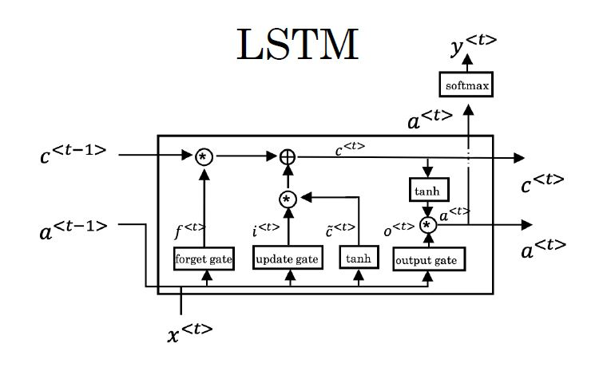
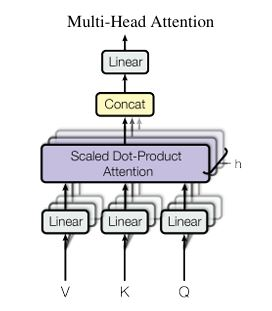
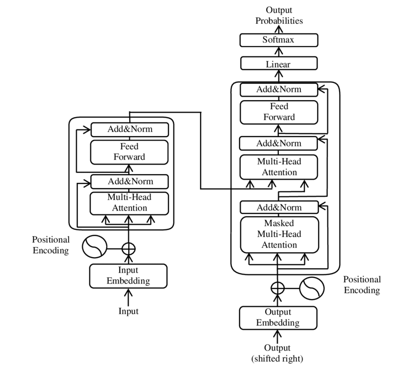

# Mini_GPT

A lightweight implementation of a transformer-based language model inspired by the architecture described in "Attention Is All You Need" (Vaswani et al., 2017).



## Project Overview

Mini_GPT is an educational project that implements a simplified version of the transformer architecture, which forms the backbone of models like GPT (Generative Pre-trained Transformer). This implementation focuses on the key components of transformers:

- Self-attention mechanism
- Multi-head attention
- Feed-forward neural networks
- Position encoding

## Key Features

- **Self-Attention**: Implementation of the core attention mechanism that allows the model to focus on different parts of the input sequence
- **Multi-Head Attention**: Parallel attention mechanisms that enable the model to focus on different aspects of the sequence simultaneously
- **Positional Encoding**: Sine and cosine functions to encode the position of tokens in the sequence
- **Encoder-Decoder Architecture**: Complete transformer structure for sequence-to-sequence tasks

## Technical Details

### Self-Attention

The self-attention mechanism computes a weighted sum of all words in a sequence, where the weights are determined by how relevant each word is to the current word being processed:

```
A(q, K, V) = ∑ (exp(q·k<i>) / ∑ exp(q·k<j>)) * v<i>
```

In matrix form:

```
Attention(Q, K, V) = softmax(QK^T/√dk)V
```

Where:

- Q: Query matrix
- K: Key matrix
- V: Value matrix
- dk: Scaling factor (dimension of keys)

### Multi-Head Attention



Multi-head attention applies the self-attention mechanism multiple times in parallel:

```
MultiHead(Q, K, V) = concat(head1, head2, ..., headn)W^O
headi = Attention(W^Q_i Q, W^K_i K, W^V_i V)
```

Each head can focus on different aspects of the sequence (e.g., "Who did what?", "When?", etc.).

### Transformer Architecture



The complete transformer architecture consists of:

1. Encoder stack with multi-head attention and feed-forward layers
2. Decoder stack with masked multi-head attention, multi-head attention over encoder output, and feed-forward layers
3. Positional encoding to provide sequence order information

## Getting Started

```bash
# Clone the repository
git clone https://github.com/sskhandle/mini-gpt.git
cd mini-gpt

# Create a virtual environment
python -m venv venv
source venv/bin/activate  # On Windows: venv\Scripts\activate

# Install dependencies
pip install -r requirements.txt

# Download the following file and place it in the specified folders
# /src/apps/question_answering/model/tensorflow and /src/apps/named_entity_recognition/model/ 
https://huggingface.co/google/mt5-base/blob/2e1532e3c3ac67f4e8ed3c4a4d95a2fa0d694fd3/tf_model.h5

# /src/preprocessing/glove/
https://huggingface.co/datasets/SLU-CSCI4750/glove.6B.100d.txt

# Run the scripts (each one is standalone)
python src/preprocessing/preprocessing.py
python src/transformer_network/transformer.py
python src/apps/named_entity_recognition/ner.py
python src/apps/question_answering/qa.py
```

## References

- Vaswani et al. (2017). "Attention Is All You Need"
