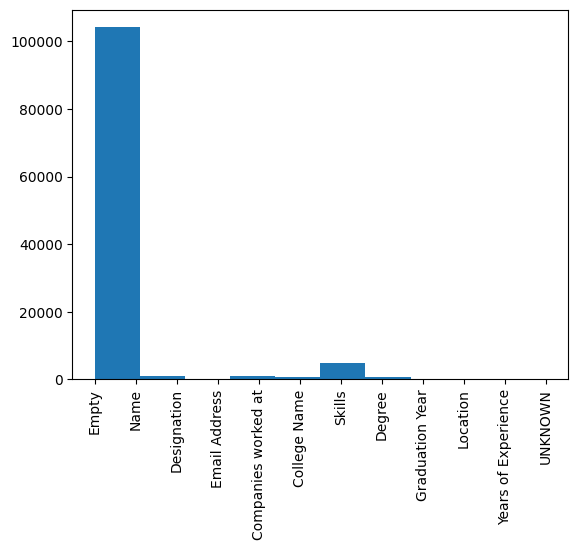
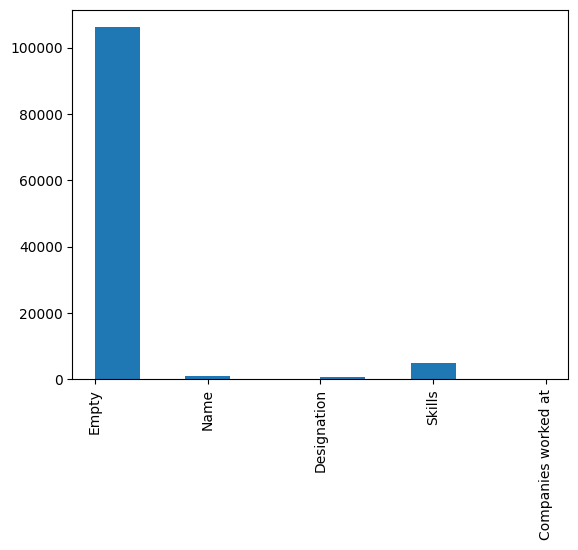

# Named entity recognition workflow

Script: `../ner.py`. Uses `ner.json`, `tokenizer/` and `model/` next to it.

1. Load `ner.json` (220 annotated resumes), drop `extras` and replace newlines with spaces.

   Tables: [raw](cell7_table.html), [with merged entities](cell11_table.html), [word tags](cell18_table.html).
2. Convert the annotations to `(text, entities)` and trim whitespace from the spans.
3. Give each word a tag, or `Empty` if it has none. There are 12 tags: College Name, Companies worked at, Degree, Designation, Email Address, Empty, Graduation Year, Location, Name, Skills, UNKNOWN, Years of Experience.
4. Pad the tag ids to 512 with `Empty`.
5. Tokenize with `DistilBertTokenizerFast` (max length 512). Sub-tokens take their word's tag and special tokens get -100.
6. Train `TFDistilBertForTokenClassification`: Adam 1e-5, batch 4, 10 epochs. Loss went from 0.80 to about 0.37 and accuracy from 0.71 to 0.76.
7. Evaluate with `seqeval` and plot the label counts.

## Results

True label counts: Empty 103155, Skills 4704, Designation 1100, Name 1035, Companies worked at 908, College Name 792, Degree 598, Location 116, Graduation Year 80, Email Address 76.

F1 per tag: Empty 0.97, Name 0.86, Skills 0.60, Designation 0.28. Degree, Email Address, Location and Years of Experience scored 0. The model mostly predicts `Empty` and `Skills`.
