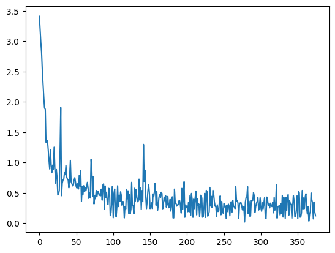

# Question answering workflow

Script: `../qa.py`. Uses `data/`, `tokenizer/` and `model/{tensorflow,pytorch}` next to it.

1. Load the bAbI dataset (1000 train, 1000 test stories). Each story has two facts and one question, such as "What is north of the kitchen?" with the answer `office`.
2. Flatten it and add `question`, `sentences` (the two facts joined) and `answer`.
3. Find the answer's start and end character in `sentences`.
4. Tokenize and map those characters to start and end token positions.
5. Train the TensorFlow model (`TFDistilBertForQuestionAnswering`) with a `GradientTape` loop: Adam 3e-5, batch 8, 3 epochs. The loss is the mean of the start and end losses.

   

   "What is south of the bedroom?" gave **Garden**.
6. Train the PyTorch model (`DistilBertForQuestionAnswering`) with `Trainer`: 3 epochs, batch 8, 20 warmup steps, weight decay 0.01. Scores are macro F1 on start and end positions.

   | Metric | Value |
   |---|---|
   | train loss | 0.573 (375 steps, about 17 min) |
   | eval loss | 0.326 |
   | F1 start | 0.809 |
   | F1 end | 0.805 |

   "What is east of the hallway?" gave **Kitchen**.

`results/` holds the TensorBoard logs from earlier runs.

