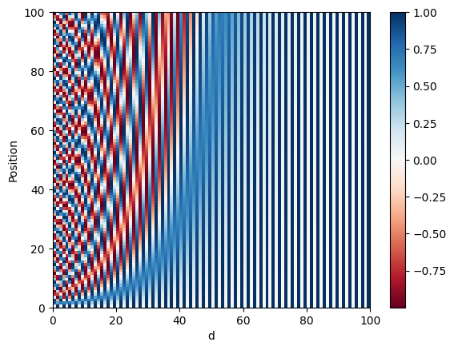
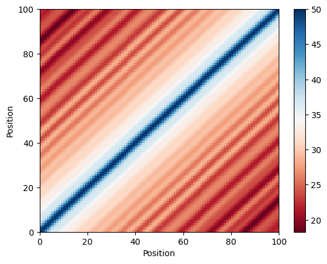
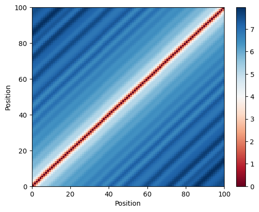
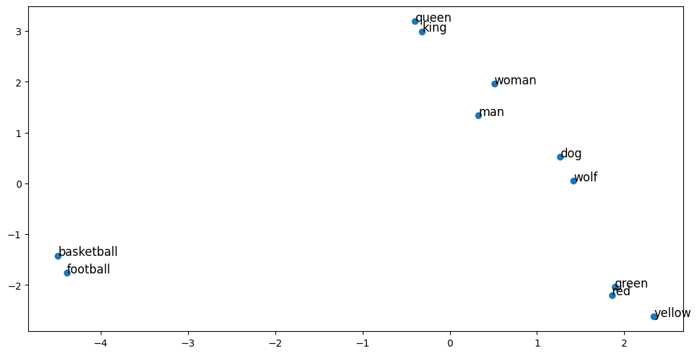
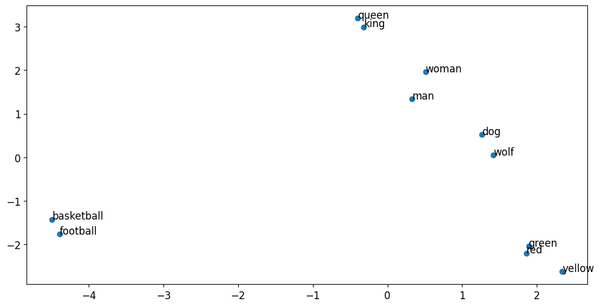
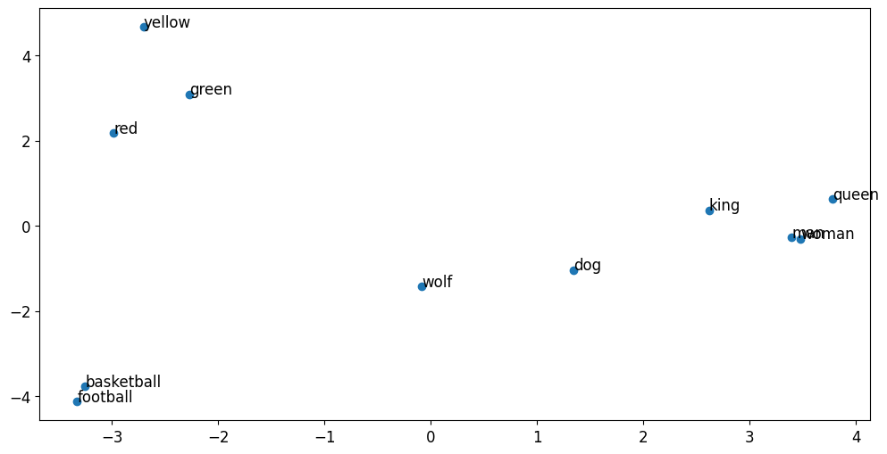
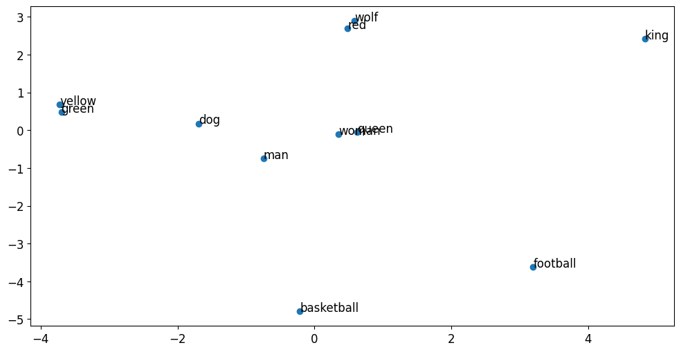
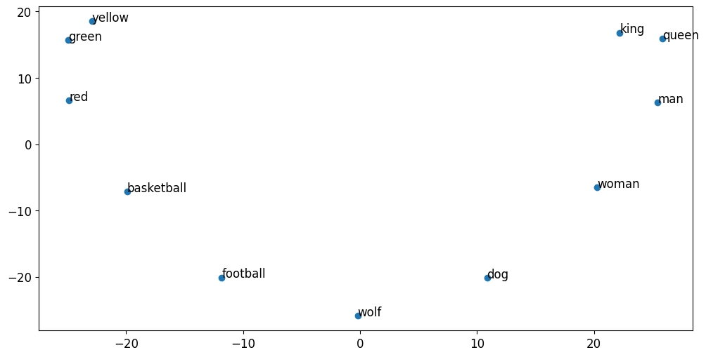
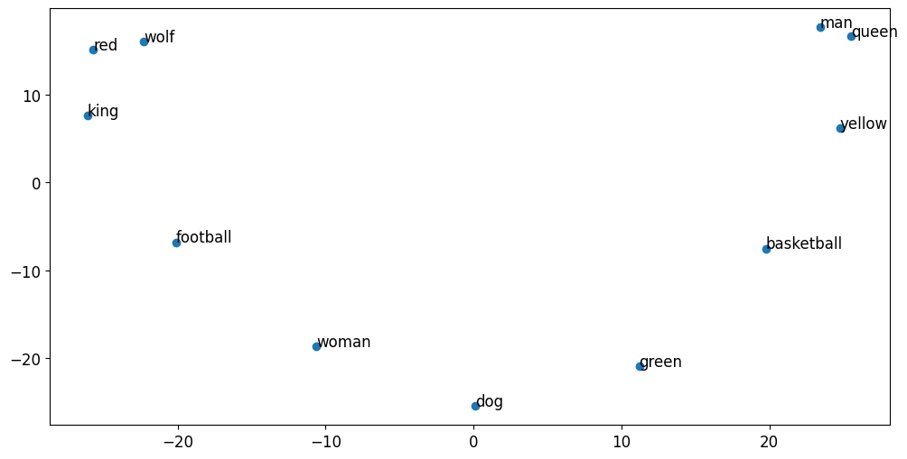

# Preprocessing workflow

Script: `../preprocessing.py`. Needs `glove/glove.6B.100d.txt` next to it.

1. Build a positional encoding (100 positions, 100 dims): sin on even indices, cos on odd.
   - The vector norm at position 34 is about 7.07.
   - Vectors 2 positions apart differ by about 3.27, whatever the position.

   

2. Compare every position with every other, using dot product and Euclidean distance.

   
   

3. Load GloVe (400,000 words, 100 dims), tokenize two sentences with the same 11 words in a different order, and pad to length 100. The frozen embedding output has shape `(2, 100, 100)`.
4. Plot the word embeddings with PCA. Both sentences look the same, since the embedding ignores word order.

   
   

5. Add the positional encoding to the embeddings. The two plots now differ.

   
   

6. Weight the positional part 10x. The words line up in a circle that follows their order.

   
   

