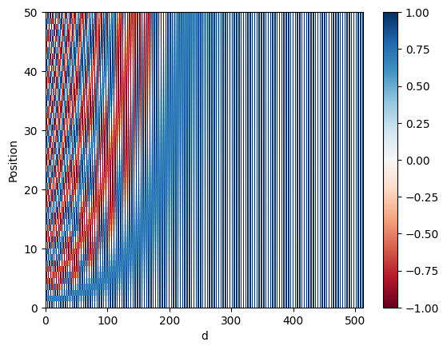

# Transformer network workflow

Script: `../transformer.py`. Run it from the `transformer_network` directory, since it imports `public_tests.py`.

## Parts

| Piece | Purpose |
|---|---|
| `get_angles`, `positional_encoding` | sin/cos position encodings |
| `create_padding_mask`, `create_look_ahead_mask` | hide padding and future tokens |
| `scaled_dot_product_attention` | softmax(QK^T / sqrt(dk) + mask) V |
| `EncoderLayer`, `Encoder` | self-attention and feed forward, stacked on embeddings plus positions |
| `DecoderLayer`, `Decoder` | masked self-attention, encoder-decoder attention, feed forward |
| `Transformer` | encoder, decoder and a softmax layer |

## Outputs

Positional encoding, 50 positions x 512 dims:



Padding mask for `[[7,6,0,0,1],[1,2,3,0,0],[0,0,0,4,5]]`:

```
[[[1. 1. 0. 0. 1.]]
 [[1. 1. 1. 0. 0.]]
 [[0. 0. 0. 1. 1.]]]
```

Look-ahead mask for length 3:

```
[[[1. 0. 0.]
  [1. 1. 0.]
  [1. 1. 1.]]]
```

Adding `(1 - mask) * -1e9` before the softmax gives masked positions zero probability.

## Tests

The tests for `get_angles`, `positional_encoding`, attention, `EncoderLayer`, `DecoderLayer` and `Decoder` passed. The `Encoder` test failed with an `AssertionError`, so it isn't run.

